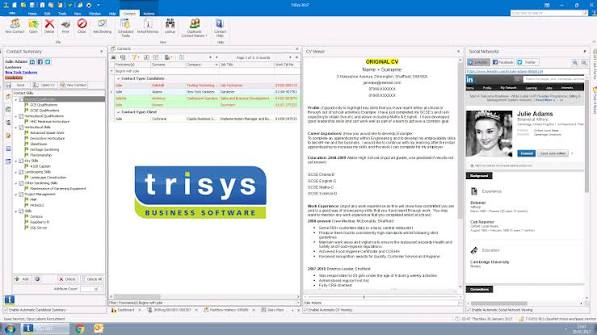

# TriSys Apex for Recruitment CRM and ATS

TriSys Apex CRM brings recruitment records and agency activity into a shared workspace.
TriSys Apex supports workflows involving candidates, clients, vacancies, and placements.
This independent overview focuses on record quality, team handovers, and reference materials.

[](https://trisys-apex-crm.github.io/TriSys-Apex/)

## Motivation

TriSys Apex software is intended for recruitment businesses managing ongoing relationships and hiring activity.
A TriSys Apex ATS workflow connects candidate progress with a particular vacancy.
A TriSys Apex recruitment CRM workflow also needs the client and contact context behind that vacancy.

A useful record tells the next recruiter what happened and what needs to happen next.
That is easier when activity notes, status changes, and ownership are kept consistent.
Define those conventions before comparing dashboards or reporting on team performance.

The files supplied in this repository come from OpenCATS.
They illustrate a separate recruitment platform and are not TriSys Apex source code.
Their routes, configuration options, and deployment requirements belong to OpenCATS.

## Key Features

Recruitment work spans several related kinds of record.
Keep the relationship between them explicit rather than repeating the same information in multiple places.
Use the installed product's controls to determine which fields and workflows are available.

| Record or activity | Operational purpose | Review question |
| --- | --- | --- |
| Candidate | Maintain professional and contact information | Is the record current and clearly identified? |
| Company and contact | Preserve the client relationship | Is the correct contact linked to the activity? |
| Vacancy or requirement | Describe the role being filled | Are requirements and ownership clear? |
| Candidate progress | Track work against a vacancy | Is the recorded stage supported by recent activity? |
| Placement | Record the outcome of recruitment work | Are the relevant parties and dates consistent? |
| Dashboard | Summarize team activity | Are period, scope, and definitions understood? |

Skills and tags are useful when their meaning is shared across the team.
Agree on a vocabulary and avoid creating near-duplicate labels for the same concept.
Review a search result against the underlying records before treating it as complete.

A dashboard is most useful when its counts can be traced to records.
Document the reporting period and the meaning of each stage.
A change in definitions can alter a trend even when the underlying activity has not changed.

The reference career-portal entry point is [index.php](careers/index.php).
A separate RSS entry point is another [index.php](rss/index.php).
Both belong to OpenCATS and do not define TriSys Apex public endpoints.


## Platform & Integrations

The vendor describes Apex as a cloud recruitment CRM accessible through a browser.
Check the current service and account configuration for the integrations available to your team.
Do not infer an integration's permissions from the fact that an account can sign in.

Email and calendar integration can support handovers when the resulting activity is recorded consistently.
Check that a message or appointment is associated with the intended record.
Use a small, representative example when validating a new workflow.

- Confirm the intended account and workspace.
- Identify the record that should receive the activity.
- Check the direction in which information is expected to move.
- Verify the result from the receiving application's view.
- Record any manual step that remains necessary.
- Keep the workflow owner clear when several people share the task.

TriSys provides developer and Web API capabilities, but application-specific examples need current documentation.
The scripts below are independent data-review examples.
They do not call TriSys Apex or claim to implement its API.

For an existing CSV review file, Windows PowerShell can count rows and group them by an Owner column.

```powershell
$rows = @(Import-Csv -LiteralPath '.\activity-review.csv')
"Rows: $($rows.Count)"
$rows | Group-Object -Property Owner | Select-Object Name, Count
```

Use the column names from the file actually being reviewed.
This does not establish that a particular TriSys export uses the same headers.
Grouping activity records is a review aid rather than a measure of recruiter effectiveness.

## Under the Hood

The included OpenCATS snapshot contains selected interface, search, and environment files.
It does not include the complete application implementation.
Use these references to understand separation of responsibilities in another recruitment platform.

**Interface presentation**

Shared styling is in [main.css](main.css).
Additional browser-specific styling appears in [not-ie.css](not-ie.css).
The error display template is [Error.tpl](Error.tpl).

Those files help distinguish presentation from the business records shown on screen.
They do not represent the TriSys Apex interface or its error handling.

**Search configuration**

The reference Sphinx configuration is [sphinx.conf](config/sphinx/sphinx.conf).
Its stop-word list is [STOPWORDS](config/sphinx/STOPWORDS).
An optional search configuration is another [sphinx.conf](optional-updates/latest-sphinx-search/sphinx.conf).

Search behavior depends on indexing choices as well as the visible query.
These OpenCATS files are not evidence of the search technology used by TriSys.
Keep search configuration and the meaning of recruitment tags separate when comparing the projects.

**Environment definitions**

The reference PHP dependencies are listed in [composer.json](composer.json).
Its containerized runtime is defined in [Dockerfile](docker/php/Dockerfile).
The related Composer preparation script is [install-composer.sh](docker/php/scripts/install-composer.sh).

These describe the supplied OpenCATS environment.
They are not requirements for accessing TriSys Apex or building a TriSys extension.

## Security

Recruitment records can contain personal contact details and confidential client information.
Use the access model configured for your organization when reviewing or sharing records.
Keep examples used for documentation separate from real candidate information.

An activity handover should contain the context needed for the next task.
Avoid copying an entire personal record into an unrelated note when a record reference is sufficient.
Review the intended recipient before sharing a report.

The following JavaScript uses fictional activity records to illustrate an incomplete handover check.
It flags records with an empty nextAction field and makes no hiring or suitability assessment.

```javascript
const activities = [
  { id: "DEMO-01", nextAction: "Confirm meeting time" },
  { id: "DEMO-02", nextAction: "" },
];
const incomplete = activities.filter(item => !item.nextAction.trim());
console.log(incomplete.map(item => item.id));
```

The objects are an independent demonstration format, not a TriSys Apex schema.
Adapt the concept only after confirming the fields used by the actual workflow.
Keep the review result tied to the original record so corrections can be checked.

The reference portal header configuration is [.htaccess](careers/.htaccess).
The supplied reverse-proxy configuration is [nginx-opencats.conf](docker/nginx-opencats.conf).
Their settings belong to OpenCATS and should be assessed in the context of that application.



## Contributing

Corrections to this overview should identify the product, workflow, and observed behavior.
Keep vendor-supported capabilities separate from proposed team conventions.
Do not describe an example record format as an official integration contract.

The reference container definitions are in [docker-compose.yml](docker/docker-compose.yml).
A separate test environment is described by [docker-compose-test.yml](docker/docker-compose-test.yml).
The PHPUnit suite configuration is [phpunit.xml.dist](phpunit.xml.dist).

These files can help orient a review of the supplied OpenCATS materials.
This partial snapshot lacks application and test files referenced by those configurations.
Their presence does not establish a working deployment or a completed test run.

When proposing a workflow change, describe the record state before and after the action.
Include how ownership and follow-up information should appear to another recruiter.
For reporting changes, define the period and the records included in each total.

## Learning and Community

The [Apex Cloud Suite page](https://www.trisys.co.uk/apex-cloud-suite) describes the vendor's service.
The [TriSys introductory guide](https://www.trisys.co.uk/welcome-to-trisys-apex-your-new-recruitment-software-platform) explains account and integration preparation.
Use the vendor's current documentation for tenant-specific settings and developer access.

For a useful support report, identify the action and the affected record type.
State whether the issue occurs consistently and which visible result differs from expectations.
Include the application context needed to reproduce the problem without adding unrelated personal data.

The examples here use Windows PowerShell and JavaScript.
They do not establish a TriSys CLI, export schema, or verified Web API request.
Confirm product-specific syntax against the documentation supplied for your environment.

## License

TriSys Apex access and source-code licensing are governed by the vendor's terms.
The included OpenCATS files retain their own upstream copyright and license requirements.
This independent overview does not establish an affiliation between the projects.
Preserve applicable notices when modifying or redistributing reference materials.

## Related Search Terms

TriSys Apex CRM, TriSys Apex, TriSys Apex software, TriSys Apex ATS, TriSys Apex recruitment CRM, recruitment, recruitment-crm, ats, applicant-tracking-systems, candidate-management, staffing, hr, business, management, onboarding
